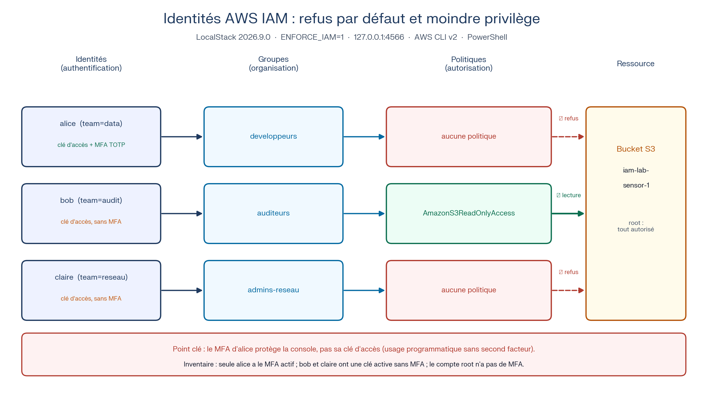
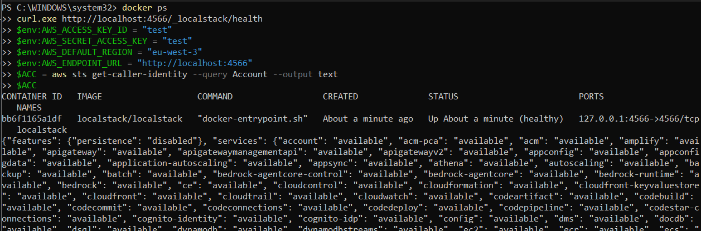
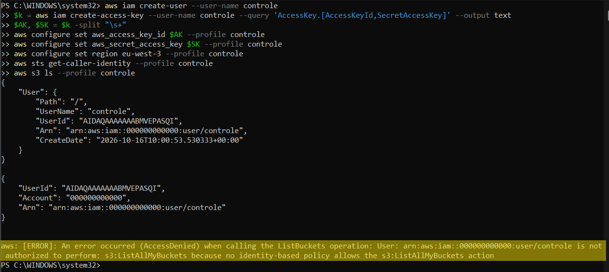
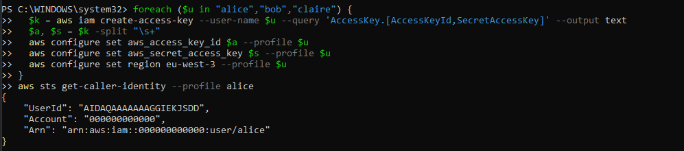
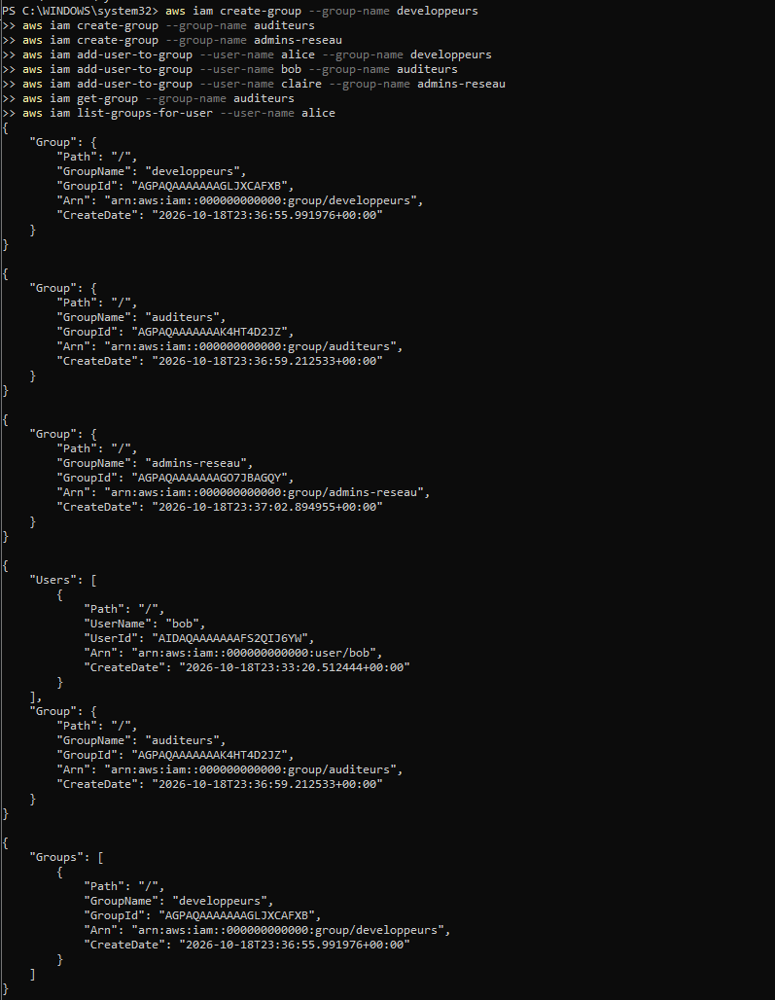
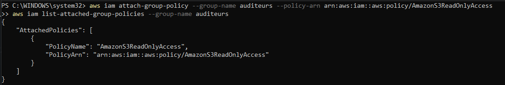
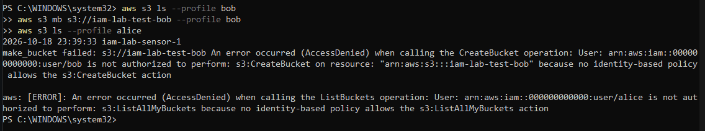
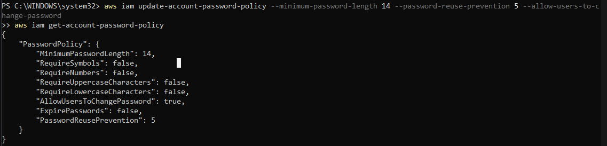
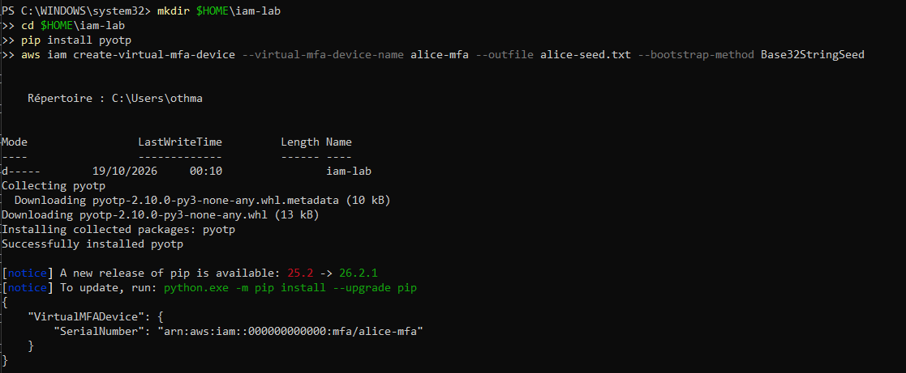
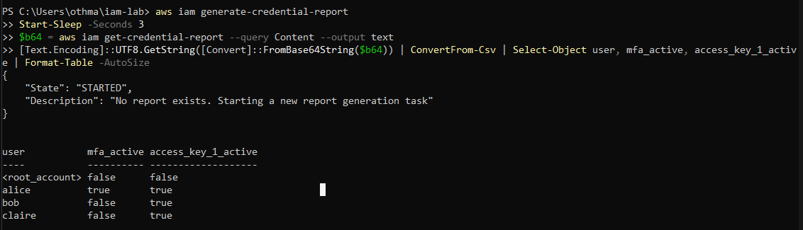

# Identités AWS IAM : refus par défaut et moindre privilège


Construire un annuaire d'identités dans un cloud AWS émulé, prouver que le refus par défaut s'applique, attribuer des droits par groupe, durcir l'authentification, puis auditer l'ensemble avec un regard **SOC** et **architecte sécurité**.



## En bref

| | |
|---|---|
| **Objectif** | Démontrer l'authentification, l'autorisation, le refus par défaut et le moindre privilège, puis relever les écarts d'une protection MFA partielle |
| **Environnement** | LocalStack 2026.9.0 avec application des permissions (`ENFORCE_IAM=1`), publié sur `127.0.0.1:4566` uniquement |
| **Identités** | 3 utilisateurs (alice, bob, claire), 3 groupes, 1 politique gérée AWS, 1 appareil MFA virtuel |
| **Outils** | AWS CLI v2, PowerShell, Docker, Python (pyotp) |
| **Approche** | Tests positifs et négatifs à chaque étape, lecture des messages de refus, inventaire final des identités |

### Résultats clés

- **Refus par défaut prouvé :** un utilisateur sans politique est authentifié mais refusé (`AccessDenied`). Le compte root, propriétaire du compte, n'est pas soumis aux politiques.
- **Droits portés par le groupe :** bob hérite de la lecture seule S3 par son groupe, peut lister les buckets, mais ne peut pas en créer. Alice, dont le groupe n'a aucune politique, reste refusée.
- **Authentification durcie :** longueur minimale de 14 caractères, historique de 5 mots de passe, sans expiration forcée ni règles de composition, conformément aux recommandations NIST SP 800-63B.
- **Point fort de l'audit :** seule alice a un MFA actif, mais les trois utilisateurs ont une clé d'accès active. Le MFA protège la connexion console, pas l'usage programmatique de la clé.
- **Reproductibilité :** l'état de l'émulateur s'est perdu au redémarrage du conteneur. Un script reconstruit désormais les identités en une exécution.

## Stack technique

| | Outil | Rôle dans le projet | Ce que cela démontre |
|---|---|---|---|
| 🧪 | **LocalStack 2026.9.0** | Émulation AWS locale avec application des permissions | Laboratoire cloud sans coût ni risque |
| 🔐 | **AWS IAM** | Utilisateurs, groupes, politiques, MFA, politique de mot de passe | Gestion des identités et des accès |
| ⌨️ | **AWS CLI v2** | Pilotage de IAM, S3 et STS, un profil par identité | Audit scriptable, tests par identité |
| 💻 | **PowerShell** | Orchestration et script de reconstruction | Automatisation sous Windows |
| 🐳 | **Docker** | Exécution isolée de l'émulateur | Reproductibilité |
| 🐍 | **Python (pyotp)** | Génération des codes TOTP du MFA virtuel | Compréhension du second facteur |

## Périmètre et règles d'engagement

Tout se déroule dans un environnement de test local, sans compte AWS réel. Les identifiants `test` sont fictifs. Le port de l'émulateur n'écoute que sur `127.0.0.1`. Le secret du MFA est supprimé après l'enrôlement et les profils de la CLI sont nettoyés en fin de session. Aucune clé ni aucun secret n'est versionné.

## Modèle d'identités

| Utilisateur | Étiquette | Groupe | Politique du groupe | Droit effectif sur S3 |
|---|---|---|---|---|
| alice | `team=data` | developpeurs | aucune | Aucun (refus par défaut) |
| bob | `team=audit` | auditeurs | `AmazonS3ReadOnlyAccess` | Lecture et listage |
| claire | `team=reseau` | admins-reseau | aucune | Aucun (refus par défaut) |

Les étiquettes préparent un contrôle d'accès par attributs. Les droits suivent la fonction (le groupe), pas la personne.

## Méthodologie et résultats

### 1. Démarrer l'environnement et prouver l'application des permissions

```powershell
docker run -d --name localstack -p 127.0.0.1:4566:4566 `
  -e LOCALSTACK_AUTH_TOKEN=$env:LOCALSTACK_AUTH_TOKEN `
  -e ENFORCE_IAM=1 -e DEBUG=1 localstack/localstack

$env:AWS_ACCESS_KEY_ID = "test"
$env:AWS_SECRET_ACCESS_KEY = "test"
$env:AWS_DEFAULT_REGION = "eu-west-3"
$env:AWS_ENDPOINT_URL = "http://localhost:4566"
$ACC = aws sts get-caller-identity --query Account --output text
```



Un utilisateur de contrôle sans aucun droit sert de preuve : si l'action réussit, les permissions ne sont pas appliquées et les tests suivants ne vaudraient rien.

```powershell
aws iam create-user --user-name controle
$k = aws iam create-access-key --user-name controle --query 'AccessKey.[AccessKeyId,SecretAccessKey]' --output text
$AK, $SK = $k -split "\s+"
aws configure set aws_access_key_id $AK --profile controle
aws configure set aws_secret_access_key $SK --profile controle
aws configure set region eu-west-3 --profile controle
aws sts get-caller-identity --profile controle
aws s3 ls --profile controle
```



**Lecture SOC :** le refus se lit en quatre éléments : qui (l'ARN), quelle action (`s3:ListAllMyBuckets`), sur quelle ressource, et pourquoi (aucune politique d'identité ne l'autorise). Dans un cloud réel, il correspond à un événement `AccessDenied` dans les journaux d'audit. Une série de refus provenant d'une même identité est un indicateur classique de reconnaissance.

**Lecture architecte :** le compte root n'est pas soumis aux politiques, d'où la nécessité de tester avec un utilisateur sans droits. Le nom de l'API (`ListBuckets`) n'est pas celui de l'action IAM à autoriser (`s3:ListAllMyBuckets`) : le message de refus donne le nom exact à écrire dans la politique.

### 2. Créer les identités et leurs profils

```powershell
$users = @{ alice = "data"; bob = "audit"; claire = "reseau" }
foreach ($u in $users.Keys) {
  aws iam create-user --user-name $u --tags "Key=team,Value=$($users[$u])" | Out-Null
  $k = aws iam create-access-key --user-name $u --query 'AccessKey.[AccessKeyId,SecretAccessKey]' --output text
  $a, $s = $k -split "\s+"
  aws configure set aws_access_key_id $a --profile $u
  aws configure set aws_secret_access_key $s --profile $u
  aws configure set region eu-west-3 --profile $u
}
aws iam list-users --query "Users[].{Nom:UserName,Equipe:Tags[0].Value}" --output table
aws sts get-caller-identity --profile alice
```



**Lecture SOC :** chaque personne a sa propre identité et son propre profil, sans compte partagé : c'est la base de l'imputabilité. Les identifiants sont uniques (`UserId`, ARN) et c'est l'ARN qui apparaît dans les journaux.

**Lecture architecte :** on modélise les fonctions de l'entreprise avant d'attribuer des droits. Les étiquettes `team` préparent le contrôle d'accès par attributs.

### 3. Groupes, refus par défaut et héritage

```powershell
aws iam create-group --group-name developpeurs
aws iam create-group --group-name auditeurs
aws iam create-group --group-name admins-reseau
aws iam add-user-to-group --user-name alice --group-name developpeurs
aws iam add-user-to-group --user-name bob --group-name auditeurs
aws iam add-user-to-group --user-name claire --group-name admins-reseau

$B = "iam-lab-sensor-1"
aws s3 mb s3://$B
aws s3 ls --profile alice
```



```powershell
aws iam attach-group-policy --group-name auditeurs --policy-arn arn:aws:iam::aws:policy/AmazonS3ReadOnlyAccess
aws iam list-attached-group-policies --group-name auditeurs
aws s3 ls --profile bob
aws s3 mb s3://iam-lab-test-bob --profile bob
aws s3 ls --profile alice
```




| Test | Résultat observé | Explication |
|---|---|---|
| Utilisateur de contrôle : `s3 ls` | AccessDenied | Aucune politique n'autorise l'action (refus implicite) |
| alice : `s3 ls` | AccessDenied | Authentifiée, mais son groupe n'a aucune politique |
| bob : `s3 ls` | Réussit | Il hérite de la lecture seule du groupe auditeurs |
| bob : création de bucket | AccessDenied sur `s3:CreateBucket` | La politique n'autorise que la lecture |

**Lecture SOC :** un auditeur en lecture seule qui produirait des refus répétés sur la création ou la suppression de ressources est un signal d'alerte : compte compromis ou tentative d'élévation de privilèges.

**Lecture architecte :** le moindre privilège se vérifie par des tests négatifs autant que par des tests positifs. Un contrôle d'accès jamais testé par un refus n'est pas validé.

### 4. Politique de mot de passe

```powershell
aws iam update-account-password-policy --minimum-password-length 14 --password-reuse-prevention 5 --allow-users-to-change-password
aws iam get-account-password-policy
```



La commande remplace la politique entière : un paramètre non précisé revient à sa valeur par défaut. La première exécution (longueur 14 et historique de 5 seulement) laissait `AllowUsersToChangePassword` à `false`, ce qui empêche un utilisateur de changer lui-même son mot de passe en cas de compromission. Il a été corrigé.

**Lecture architecte :** longueur privilégiée, pas d'expiration forcée ni de règles de composition, conformément aux recommandations NIST SP 800-63B. Cela contredit des référentiels de conformité plus anciens (par exemple l'expiration à 90 jours que recherchent certains outils d'audit) : il faut savoir relativiser un outil et justifier un écart.

### 5. MFA virtuel

```powershell
pip install pyotp
aws iam create-virtual-mfa-device --virtual-mfa-device-name alice-mfa --outfile alice-seed.txt --bootstrap-method Base32StringSeed
$c1 = python -c "import pyotp;print(pyotp.TOTP(open('alice-seed.txt').read().strip()).now())"
Start-Sleep -Seconds 31
$c2 = python -c "import pyotp;print(pyotp.TOTP(open('alice-seed.txt').read().strip()).now())"
aws iam enable-mfa-device --user-name alice --serial-number "arn:aws:iam::${ACC}:mfa/alice-mfa" --authentication-code1 $c1 --authentication-code2 $c2
aws iam list-mfa-devices --user-name alice
Remove-Item alice-seed.txt
```



Deux codes consécutifs prouvent que l'application et le cloud partagent le même secret et la même horloge. Le fichier du secret est supprimé immédiatement après l'enrôlement : dans la réalité, ce secret n'est affiché qu'une fois.

### 6. Inventaire des identités

```powershell
aws iam generate-credential-report
Start-Sleep -Seconds 3
$b64 = aws iam get-credential-report --query Content --output text
[Text.Encoding]::UTF8.GetString([Convert]::FromBase64String($b64)) | ConvertFrom-Csv | Select-Object user, mfa_active, access_key_1_active | Format-Table -AutoSize
```



| Identité | MFA actif | Clé d'accès active |
|---|---|---|
| `<root_account>` | non | non |
| alice | oui | oui |
| bob | non | oui |
| claire | non | oui |

## Le point à retenir : MFA et clés d'accès

Alice est la seule à avoir un MFA, mais **sa clé d'accès reste utilisable sans second facteur**. Une clé d'accès sert aux appels programmatiques (CLI, scripts) et ne demande aucun code MFA, sauf si une politique l'exige par une condition `aws:MultiFactorAuthPresent`. Quiconque vole la clé d'alice garde donc l'accès complet à ses droits : le MFA donne ici une fausse assurance.

**Lecture SOC :** surveiller l'âge et la dernière utilisation des clés, et alerter sur un usage depuis une adresse ou un pays inhabituel. Un compte privilégié sans MFA est une alerte prioritaire.

**Lecture architecte :** réduire le nombre de clés de longue durée et les remplacer par des identifiants temporaires (SSO, rôles), imposer le MFA par politique sur les actions sensibles, et activer le MFA sur le compte root, qui est ici sans second facteur.

Exemple de politique de refus sans MFA (modèle courant, non testé dans ce laboratoire) :

```json
{
  "Version": "2012-10-17",
  "Statement": [{
    "Sid": "DenyAllWithoutMFA",
    "Effect": "Deny",
    "NotAction": [
      "iam:CreateVirtualMFADevice",
      "iam:EnableMFADevice",
      "iam:ListMFADevices",
      "sts:GetSessionToken"
    ],
    "Resource": "*",
    "Condition": { "BoolIfExists": { "aws:MultiFactorAuthPresent": "false" } }
  }]
}
```

## Plan de remédiation priorisé

| Priorité | Action | Justification |
|---|---|---|
| P1 | MFA sur le compte root, aucune clé root | Le root contrôle tout le compte |
| P1 | Imposer le MFA par politique (`aws:MultiFactorAuthPresent`) sur les actions sensibles | Un MFA non exigé ne protège pas les clés d'accès |
| P1 | Remplacer les clés de longue durée par des identifiants temporaires (SSO, rôles) | Réduire l'impact d'un vol de clé |
| P2 | Supprimer ou désactiver les clés inutilisées, surveiller leur âge | Réduire la surface d'attaque |
| P2 | MFA pour tous les utilisateurs avec accès console | Résister au vol de mot de passe |
| P3 | Permissions basées sur les étiquettes `team` | Passer à l'échelle sans multiplier les politiques |

## Incident et reproductibilité

Au redémarrage du conteneur, tous les utilisateurs ont disparu : la persistance de l'émulateur est désactivée et l'état vit en mémoire. Les identités se reconstruisent désormais avec [`scripts/provision-identites.ps1`](scripts/provision-identites.ps1). Principe : un environnement jetable se reconstruit à partir d'un script, pas de mémoire.

## Limites

- L'environnement est émulé : le comportement peut différer d'un vrai compte AWS, notamment sur les contrôles de niveau compte.
- Je n'ai pas pu confirmer que l'émulateur valide les codes TOTP : un enrôlement réussi ne prouve pas qu'un code erroné serait refusé.
- Le MFA est enrôlé mais aucune politique ne l'exige : le laboratoire ne teste pas une connexion avec second facteur.
- Les clés d'accès sont des identifiants de longue durée stockés dans la configuration locale de la CLI : acceptable pour un laboratoire, à proscrire en production.
- Les horodatages sont en UTC ; un SOC corrèle ses journaux dans un fuseau unique.

## Compétences démontrées

- Gestion des identités et des accès : utilisateurs, groupes, politiques gérées, étiquettes, refus par défaut, moindre privilège.
- Lecture des messages de refus (qui, quelle action, quelle ressource, pourquoi) et lien avec les journaux d'audit.
- Authentification : politique de mot de passe argumentée (NIST), MFA TOTP, limites du MFA face aux clés d'accès.
- Audit : rapport d'identifiants, inventaire des identités, relevé d'écarts et plan de remédiation priorisé.
- Automatisation et reproductibilité : PowerShell, script de reconstruction, hygiène des secrets.

## Reproduire

1. Démarrer LocalStack avec `ENFORCE_IAM=1` (section 1).
2. Exécuter [`scripts/provision-identites.ps1`](scripts/provision-identites.ps1) pour créer utilisateurs, groupes, politique et profils.
3. Rejouer les tests des sections 3 à 6.
4. Nettoyer : arrêter et supprimer le conteneur (`docker stop localstack`, `docker rm localstack`), supprimer les profils de test de `~/.aws/credentials` et de `~/.aws/config`.

## Structure du dépôt

```text
.
├── README.md
├── scripts/provision-identites.ps1   reconstruction des identités
└── docs/images/                      schéma et captures numérotées
```

## Autres projets

- [cloud-exposure-audit-nmap-zap-prowler](https://github.com/othmane71-art/cloud-exposure-audit-nmap-zap-prowler) : audit d'exposition et de posture cloud (Nmap, OWASP ZAP, Prowler)
- [ARCHISOC-LAB-HOME](https://github.com/othmane71-art/ARCHISOC-LAB-HOME) : architecture SOC virtualisée (FortiGate, pfSense, Wazuh, honeypot Cowrie, WAF, DVWA)
- [Microsoft-Sentinel-SOC-Lab](https://github.com/othmane71-art/Microsoft-Sentinel-SOC-Lab) : SOC hybride avec Microsoft Sentinel et règles de détection KQL
- [forensic-artefacts-goad-mini-kali](https://github.com/othmane71-art/forensic-artefacts-goad-mini-kali) : investigation forensic live sur Windows Server AD et Kali Linux
